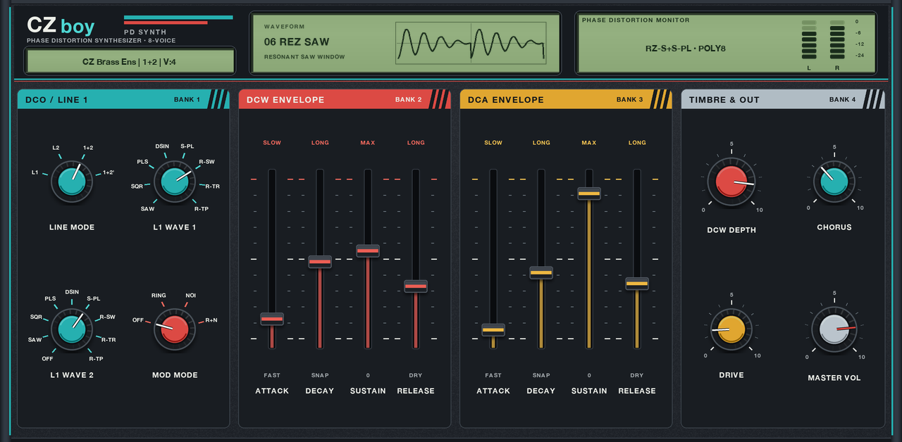

# CZboy — Phase Distortion Synthesizer for Akai MPC



**CZboy** (`UID: CZBY`, vendor `Stampman3000`) is a standalone 1984 CZ-101-style Phase Distortion synthesizer for Akai MPC OS 3.10.1+ (32-bit ARM32 Cortex-A17 & 64-bit ARM64), based on the fixed-point C++ [**CrispyZebra**](https://github.com/hugelton/CrispyZebra) Phase Distortion engine by Leo Kuroshita (`@kurogedelic`).

Licensed under the **GNU General Public License v3.0 or later (GPL-3.0-or-later)** — see [LICENSE](LICENSE) and [NOTICE.md](NOTICE.md).

## Highlights
- **Studio-Clean NEC uPD933-Accurate Casio CZ-101 Phase Distortion Core (`dsp/CrispyZebra.h`, `dsp/CzBoyEngine.h`)**:
  - All 8 classic CZ waveforms (**Saw**, **Square**, **Pulse**, **Double Sine**, **Saw-Pulse**, **Rez Saw**, **Rez Tri**, **Rez Trap**) rendered with a 2048-point linear-interpolated unipolar cosine LUT (`> 100 dB` sine purity), **exponential Casio DCW knee curves**, **exponential 3.8-octave musical resonant sweeps (`1×–14×` with frequency-aware Nyquist guard)**, **click-free continuous `Wave 1 + Wave 2` cycle splicing**, per-sample smoothed envelopes (zero zipper noise), pitch-tracked LFSR phase-noise mod, high-headroom linear stereo polyphonic bus, and a gentle `13.5 kHz` CZ-101 analog output silk filter.
  - **Live Real-Time Timbre Control:** Dedicated **`DCW Timbre`** (instant live phase-distortion floor/cutoff) + **`DCW Env`** (live DCW envelope depth) alongside smooth logarithmic (`3 ms – 6.6 s`) **DCW** and **DCA** ADSR envelopes.
  - **Stereo Voice Spread, Dual-Line Layering & Ambient Space FX:** Natural per-voice stereo panning in `Poly 8` / `Poly 4` (dead center in `Mono`), `Line 1 / Line 2 / 1+2 / 1+2'`, post-ring DCA **Ring Mod** & pitched LFSR **Noise Mod**, **L2 Mix / L2 DCW / bipolar L2 Env Ofs**, silky sine-LFO **Stereo Chorus**, and an airy diffused tempo-synced stereo **Space FX** (`Space Send` true pre-delay send + `Space Decay`).
- **32 Factory Presets (`bridge/CzBoyPresets.h`)**:
  - **Boards of Canada Glassy Sines & Ambient Pads:** *BoC Glassy Sine*, *Olson VHS Sine*, *Roygbiv Sine Ld*, *Turquoise Glass*, *NFB Film Organ*, *Dayvan Glass Pad*, *Crystal Tine EP*, *Aphex SAW Pad*, *Rhubarb Glass*.
  - **Fat PD Basses & Leads:** *Fat Rez Bass*, *Acid Rez Squelch*, *Electro Slap Bs*, *Deep Sub Pulse*, *Hollow House Bs*, *Rubber Techno Arp*, *Detuned Rave Ld*, *Metallic Clav*.
  - **Converted CZ-101 Classics:** *Velvet 1+2' Pad*, *Tubular Chimes*, *Woody Marimba*, *Bright Harpsi*, *Slap Horn Funk*, *Light Harp Pluck*, *Breathy Pan Pipe*.
  - **Synthy Noises & IDM Textures:** *Sci-Fi Ring Zaps*, *Noise Wind Sweep*, *Broken Arcade*, *Radio Static Bell*, *Electro Synth Tom*, *Glitch PD Blip*, *Cyber Drone FX*, *Init CZ Saw*.
- **1984 Casio CZ-101 Hardware Faceplate UI (`1280 × 628`, `tools/gen_ui_assets.py`)**:
  - Matte jet-charcoal ABS faceplate with hairline `DCO → DCW → DCA` schematic framing, brushed-silver chamfered green-grey LCD (2-line readout + live 8-waveform PD scope + stereo LCD meters), printed 8-waveform legend table, flat matte-black CZ-style rotary dials, and compact Casio mini-sliders across 2 tabs (**`CZ-101`** and **`LINE 2/MOD`**) with 100% 4×4 hardware Q-Link coverage.
- **Roadmap (post-v1)**:
  - CZ `.syx` SysEx patch loading (`pdsynth`-style) and full 8-stage envelope point editing are planned for a later release, not v1.

## Desktop CPU Reference (44.1 kHz, 128-frame = 2902.5 µs)
*(On-device Gen1 MPC One ARMv7 benchmarks pending hardware capture.)*

| Scenario | Avg (µs) | p99 (µs) | Desktop % of 128-frame |
| :--- | ---: | ---: | ---: |
| Line 1 Only (4 voices, dry) | 6.3 µs | 7.6 µs | **0.22%** |
| Line 1 Only (8 voices, dry) | 10.1 µs | 18.9 µs | **0.35%** |
| Dual-Line 1+2 + Chorus (8 voices) | 18.1 µs | 30.1 µs | **0.62%** |
| Dual-Line + Chorus + Space FX (8 voices) | 16.3 µs | 27.9 µs | **0.56%** |
| Dual-Line Ring+Noise+Chorus+Space (8v) | 20.2 µs | 32.0 µs | **0.69%** |

## Build & Verify
Set `MPC_SDK` to a checkout of the official [Akai MPC Plugin Builder SDK](https://github.com/inmusic-software/mpc-plugin-builder-sdk), then:

```bash
bash tools/build_all.sh
bash tools/run_tests.sh
```

Deployable archive: `dist/czboy-1.0.0-mpc.zip` (extract `"Stampman3000 - VST - CZboy"` into `VST2 Plugins/` on your MPC drive).

## Credits
- **Synthesis Engine**: [CrispyZebra](https://github.com/hugelton/CrispyZebra) by Leo Kuroshita (`@kurogedelic`, GPL-3.0).
- **MPC Port, UI & Presets**: Stampman3000.

☕ If this saves you time, you can [buy me a coffee](https://paypal.me/johnnybarter1).
