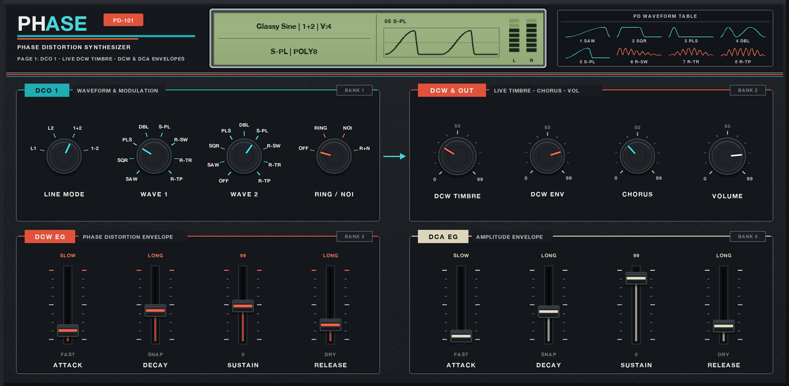

# Phase — Phase Distortion Synthesizer for Akai MPC



**Phase** (`UID: PHSE`, vendor `Stampman3000`) is a standalone CZ-derived Phase Distortion polyphonic synthesizer for Akai MPC OS 3.9.1 and 3.10.1+ (32-bit ARMv7 and 64-bit AArch64), built on Leo Kuroshita's GPL-3 C++ [**CrispyZebra**](https://github.com/hugelton/CrispyZebra) engine.

Licensed under the **GNU General Public License v3.0 or later (`GPL-3.0-or-later`)** — see [LICENSE](LICENSE) and [NOTICE.md](NOTICE.md).

## Sound & Character
Inspired by 1980s Casio CZ phase-distortion synths, Phase morphs a clean interpolated cosine core into 8 classic PD waveform families — **Saw**, **Square**, **Pulse**, **Double Sine**, **Saw-Pulse**, **Rez Saw**, **Rez Tri**, and **Rez Trap** — with per-cycle `Wave 1 + Wave 2` alternation on two independent lines.

- **Glassy Sines to Classic Saws:** A convex Casio-style DCW response keeps the lower half of the timbre sweep in warm sine, woody electric piano, and crystalline bell territory with zero buzz (`> 100 dB` sine purity), while opening smoothly into luminous 80s brass, strings, and biting 90s detuned saws at higher settings.
- **Liquid Resonant Sweeps:** Unipolar windowed-sync resonant waveforms sweep exponentially across 3.6 octaves with a frequency-aware anti-aliasing floor, giving punchy resonant basses, vocal pads, and isolated glassy attack tines.
- **Vintage Movement & Space:** Includes subtle per-voice aged-hardware calibration drift, a free-running sine + slow tape-wow vibrato LFO that glides through release tails, post-ring DCA Ring Mod, pitched LFSR phase-noise mod, dual-tap stereo BBD chorus, and a tempo-synced diffused stereo **Space FX** with true pre-delay send.
- **32 Factory Presets (`bridge/PhasePresets.h`):**
  - **Glassy Sines & Ambient Pads:** *Glassy Sine*, *Warm Tape Sine*, *Soft Sine Lead*, *Crystal Sine Pad*, *Hollow Tape Organ*, *Ambient Phase Pad*, *Fragile Glass Pad*, *Deep Drift Drone*.
  - **80s / 90s Saws, Brass, Strings & Pads:** *80s Poly Saw*, *90s Rave Saw Stab*, *80s Synthwave Saw*, *90s Detuned Lead*, *80s Brass Ens*, *Warm PD Strings*, *Velvet 1-2 Pad*.
  - **Fat PD Basses, Acid & Arps:** *Fat Rez Bass*, *Acid Rez Squelch*, *Electro Slap Bs*, *Deep Sub Pulse*, *Hollow House Bs*, *Rubber Techno Arp*.
  - **Keys, Bells & Plucked:** *Crystal Tine EP*, *Metallic Clav*, *Tubular Chimes*, *Woody Marimba*, *Bright Harpsi*, *Light Harp Pluck*.
  - **Wind, FX, Drums & Init:** *Breathy Pan Pipe*, *Sci-Fi Ring Zaps*, *Noise Wind Sweep*, *Electro Synth Tom*, *Init PD Saw*.

## Installation

Download the zip matching your MPC from [Releases](https://github.com/stampman3000-jpg/phase/releases):
- **Gen1 MPC (MPC One, Live, Live II, X, Key 61, Force — 32-bit ARMv7):** `Phase-1.0.0-mpc-armv7.zip`
- **Gen2 MPC (64-bit AArch64):** `Phase-1.0.0-mpc-aarch64.zip`

### MPC OS 3.10.1+ (Official External VST Plugins)
1. Enable **Preferences → Enhancements → External Plugin Support** on your MPC.
2. Unzip the archive and copy `portable/Stampman3000 - VST - Phase` into `VST2 Plugins/` at the root of your SD card, USB drive, or internal drive (or install directly via the [OpenMPC Plugin Manager](https://open-mpc.github.io/)).
3. Load **Phase** from **External VST Plugins → Stampman3000**.

### MPC OS 3.9.1
Unzip and follow `INSTALL.md` inside the archive (or install via the OpenMPC Plugin Manager / desktop installer).

## Controls & Parameters

Phase exposes 32 automatable parameters organized into two 1280×628 touchscreen pages with 100% 4×4 hardware Q-Link coverage.

### Page 1 — `PHASE` (Core Voice, DCW Timbre & Envelopes)

| Bank | Control | Range / Options | Description |
| :--- | :--- | :--- | :--- |
| **Bank 1 (DCO)** | `Line Mode` | `Line 1`, `Line 2`, `1 + 2`, `1 - 2` | Line routing (`1 - 2` subtracts Line 2 for hollow phase-cancelled PWM timbres) |
| | `L1 Wave 1` | `Saw`..`Rez Trap` (8) | Line 1 primary PD waveform |
| | `L1 Wave 2` | `Off`, `Saw`..`Rez Trap` (9) | Alternating second waveform per cycle on Line 1 |
| | `Mod Mode` | `Off`, `Ring Mod`, `Noise`, `Ring+N` | Post-ring DCA ring modulation & pitched LFSR phase-noise |
| **Bank 2 (DCW)** | `DCW Timbre` | `0–100%` | Live real-time phase-distortion floor / brightness |
| | `DCW Env` | `0–100%` | Live DCW envelope depth |
| | `Chorus` | `0–100%` | Dual-tap sine-LFO stereo BBD chorus |
| | `Master Vol` | `0–100%` | Output level |
| **Bank 3 (DCW EG)** | `DCW Attack` | `0–100%` (`3 ms – 6.6 s`) | DCW envelope attack |
| | `DCW Decay` | `0–100%` (`3 ms – 6.6 s`) | DCW envelope decay |
| | `DCW Sustain` | `0–100%` | DCW sustain level |
| | `DCW Release` | `0–100%` (`3 ms – 6.6 s`) | DCW release time |
| **Bank 4 (DCA EG)** | `DCA Attack` | `0–100%` (`3 ms – 6.6 s`) | Amplitude attack |
| | `DCA Decay` | `0–100%` (`3 ms – 6.6 s`) | Amplitude decay |
| | `DCA Sustain` | `0–100%` | Amplitude sustain level |
| | `DCA Release` | `0–100%` (`3 ms – 6.6 s`) | Amplitude release time |

### Page 2 — `LINE 2 / MOD` (Detune, Layering, Pitch, Vibrato & Space FX)

| Bank | Control | Range / Options | Description |
| :--- | :--- | :--- | :--- |
| **Bank 1 (L2 DCO)** | `L2 Wave 1` | `Saw`..`Rez Trap` (8) | Line 2 primary PD waveform |
| | `L2 Wave 2` | `Off`, `Saw`..`Rez Trap` (9) | Alternating second waveform per cycle on Line 2 |
| | `L2 Octave` | `-2` .. `+2` | Line 2 octave shift |
| | `L2 Semi` | `-12` .. `+12 st` | Line 2 semitone interval |
| **Bank 2 (L2 Mix)** | `L2 Fine` | `-60` .. `+60 ct` | Line 2 fine detune |
| | `L2 Mix` | `0–100%` | Line 2 level / Ring Mod wet blend |
| | `L2 DCW` | `0–100%` | Line 2 DCW trim relative to Line 1 |
| | `L2 Env Ofs` | `-100%` .. `+100%` | Bipolar Line 2 envelope timing offset (snappy tine ↔ slow bloom) |
| **Bank 3 (Mod)** | `Pitch Env` | `0–100%` | DCO pitch envelope depth |
| | `Pitch Dec` | `0–100%` | DCO pitch envelope decay |
| | `Vib Rate` | `0–100%` (`0.15 – 12 Hz`) | Logarithmic vibrato & slow tape-wow rate |
| | `Vib Depth` | `0–100%` | Vibrato depth (also responds to MIDI CC 1 Mod Wheel) |
| **Bank 4 (Space)** | `Voice Mode` | `Poly 8`, `Poly 4`, `Mono` | Polyphony mode |
| | `Glide` | `0–100%` | Portamento time |
| | `Space Send` | `0–100%` | True pre-delay send into diffused stereo Space FX |
| | `Space Decay` | `0–100%` | Space feedback & ambient tail length |

## Build & Verify

Phase cross-compiles both **ARMv7 (32-bit)** and **AArch64 (64-bit)** binaries using the official [Akai MPC Plugin Builder SDK](https://github.com/inmusic-software/mpc-plugin-builder-sdk) (`tools/build.py` with Zig, matching OP3000 and Twenty — GCC and Docker toolchains are also supported by `build.py --toolchain gcc|docker`):

- **Common flags:** `-std=c++17 -O2 -fPIC -fvisibility=hidden -ffunction-sections -fdata-sections -Wall -Wextra`
- **ARMv7 (`VST/phase-arm32.so`):** Zig `-target arm-linux-gnueabihf.2.31 -mcpu=cortex_a17` (GCC: `-march=armv7-a -mfpu=neon-vfpv4 -mfloat-abi=hard`, max GLIBC 2.29)
- **AArch64 (`VST/phase-arm64.so`):** Zig `-target aarch64-linux-gnu.2.31 -mcpu=cortex_a55` (GCC: `-march=armv8-a`, max GLIBC 2.29)

```bash
# Build skins, ARM32/ARM64/native binaries, validate, and package both per-arch zips
MPC_SDK=/path/to/mpc-plugin-builder-sdk OPEN_MPC=/path/to/mpc-vst-plugins bash tools/build_all.sh

# Run all 10 DSP tests, desktop CPU benchmark, and official Akai host_sim
MPC_SDK=/path/to/mpc-plugin-builder-sdk bash tools/run_tests.sh
```

Release archives:
- `dist/Phase-1.0.0-mpc-armv7.zip`
- `dist/Phase-1.0.0-mpc-aarch64.zip`

## Desktop CPU Reference (44.1 kHz, 128-frame = 2902.5 µs)
*(Tested live on Gen1 MPC One ARMv7; formal on-device `bench.sh` numbers pending capture.)*

| Scenario | Avg (µs) | p99 (µs) | Desktop % of 128-frame |
| :--- | ---: | ---: | ---: |
| Line 1 Only (4 voices, dry) | 6.8 µs | 18.7 µs | **0.23%** |
| Line 1 Only (8 voices, dry) | 12.9 µs | 22.9 µs | **0.44%** |
| Dual-Line 1+2 + Chorus (8 voices) | 23.3 µs | 37.6 µs | **0.80%** |
| Dual-Line + Chorus + Space FX (8 voices) | 22.4 µs | 34.4 µs | **0.77%** |
| Dual-Line Ring+Noise+Chorus+Space (8v) | 34.4 µs | 51.5 µs | **1.19%** |

## Known Limits
- **Envelopes:** Uses streamlined 4-stage ADSR envelopes (with bipolar Line 2 offset) rather than 8-stage CZ rate/level breakpoint editing.
- **SysEx:** `.syx` patch import is not included in v1.0.0.
- **CZ-Derived DSP:** Tuned for clean, musical playability on MPC rather than bit-exact hardware emulation; not A/B matched against a physical CZ-101.
- **Testing:** Tested on Gen1 MPC One (MPC OS 3.10.1, ARMv7) and verified via Akai SDK `validate`, `host_sim`, and OpenMPC `catalog_check.py`; AArch64 (`arm64`) binary is built and validated but not yet tested on Gen2 hardware.

## Credits
- **Synthesis Engine:** [CrispyZebra](https://github.com/hugelton/CrispyZebra) by Leo Kuroshita (`@kurogedelic`, GPL-3.0).
- **MPC Port, DSP Modifications, UI & Presets:** Stampman3000.
- **SDK & Packaging:** [Akai MPC Plugin Builder SDK](https://github.com/inmusic-software/mpc-plugin-builder-sdk) and [Open MPC](https://open-mpc.github.io/).

☕ If this saves you time, you can [buy me a coffee](https://paypal.me/johnnybarter1).
